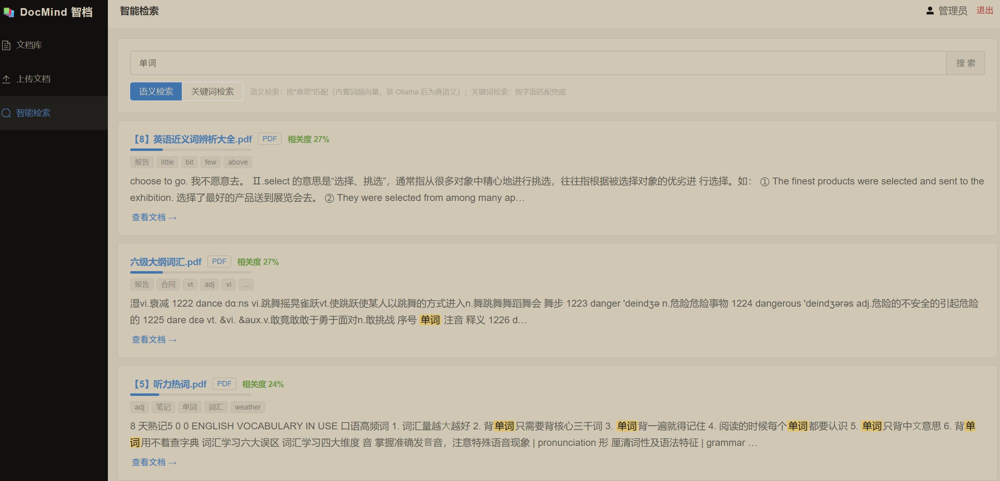
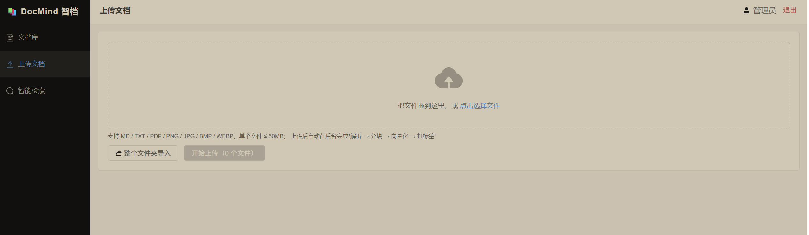
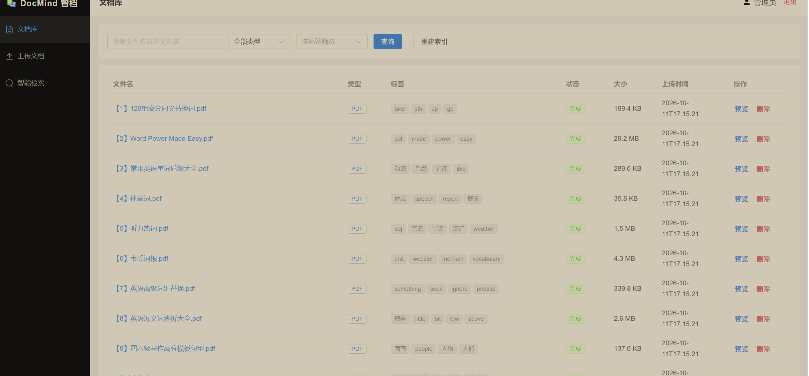
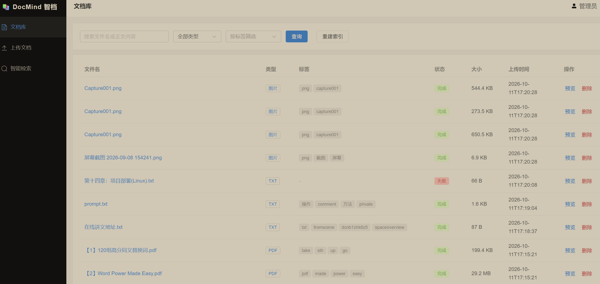

# 📚 DocMind 智档 | 私有化 RAG 文档知识库（SpringBoot3 + Vue3 前后端分离）

    

> 把散落在电脑各处的 MD 笔记、TXT、PDF、截图拖进来，系统自动完成 **解析 → 分块 → 向量化 → 建索引 → 自动打标签**；
> 之后用一句自然语言，就能找到"内容在哪个文档、命中哪一段"，附带**相关度百分比 + 片段高亮**。
> 所有数据、所有模型、所有计算都在你自己的电脑上 —— **不出内网、不调云端 API、不花一分钱**。

---

## 1. 项目简介

### 1.1 解决什么问题

| # | 痛点 | DocMind 的答案 |
|---|------|----------------|
| 1 | 几百个文件分散各处，Windows 搜索**只能搜文件名** | 穿透文件名，直接搜**正文内容**，语义/关键词双模式 |
| 2 | 云笔记：隐私（传第三方）、付费（智能搜索收费）、锁定（难导出） | 全本地部署：文件、向量、模型都在本机 |
| 3 | 截图和扫描 PDF 是**搜索黑洞**，专业 OCR 工具门槛高 | 内置 Tesseract OCR，图片/扫描 PDF 自动提取文字进索引 |
| 4 | 打标签、归类整理坚持不了三天 | 上传即自动打标签（规则分类 + jieba 词频），无需人工 |

### 1.2 和 RAG 的关系（诚实定位）

本项目实现的是 RAG（Retrieval-Augmented Generation，检索增强生成）中的 **Retrieval 检索层**：
文档解析 → 分块（500 字/重叠 100 字）→ 向量化 → 相似度召回 → 按文档聚合重排。
生成层（LLM 总结问答）刻意没有内置——个人知识库场景"找得准"是第一需求，且这样检索层可以做到**零大模型依赖、完全免费**。
检索结果已按相关度排好序，想升级成完整问答，把 Top 结果拼进 Prompt 接一个本地 LLM（如 Ollama 部署 qwen）即可，接口已预留。

### 1.3 核心功能

- **多格式内容级检索**：MD / TXT / PDF / 图片(OCR) / 扫描版 PDF（渲染成图再 OCR）
- **语义检索**：按"意思"匹配，返回相关度百分比 + 命中片段高亮
- **关键词检索兜底**：LIKE 匹配文件名和全文，向量化服务不可用时也能搜
- **全自动归档流水线**：上传即后台异步处理，列表实时显示 处理中/完成/失败
- **自动标签**：规则分类（会议/报告/论文/简历…）+ jieba 词频 TopN，预览页可手动改
- **整个文件夹批量导入** + MD5 内容去重 + 搜索历史 + 结果缓存 + 一键重建索引

### 1.4 技术栈

| 层 | 技术 | 说明 |
|---|---|---|
| 前端 | Vue3 + Vite + Element Plus + Pinia + Vue Router | 5 个页面，组件化清晰 |
| 后端 | Spring Boot 3 + MyBatis-Plus + Spring Validation | controller / service / mapper 三层 |
| 存储 | MySQL 8（元数据 + 分块向量 BLOB）+ 本地磁盘（原始文件） | 无额外数据库 |
| 缓存 | Redis（登录态 + 检索缓存） | **不可用时自动降级，系统照常运行** |
| 分词 | jieba-analysis | 自动标签、内置向量化 |
| 解析 | commonmark / Apache PDFBox / tess4j(Tesseract) | 全部纯 Java，无 Python 依赖 |
| 向量化 | 内置词频向量（默认）/ Ollama bge-m3（可选） | **可插拔接口，一行配置切换，均免费本地** |
| 认证 | JWT + HandlerInterceptor + ThreadLocal | 20 行讲清楚的方案，未用 Spring Security |

### 1.5 架构

```
┌───────────────────────────────────────────────────────┐
│              浏览器  Vue3 + Element Plus (:5173)        │
│   登录页 │ 文档上传 │ 文档列表 │ 智能检索 │ 文档预览      │
└──────────────────────────┬────────────────────────────┘
                           │ HTTP/JSON（Authorization: Bearer <JWT>）
┌──────────────────────────▼────────────────────────────┐
│                 SpringBoot3 后端 (:8080)                │
│ Controller：Auth / Document / Search / Tag             │
│ Service：                                              │
│  ├ 文档解析  MD/TXT直读 · PDF→PDFBox · 图片/扫描PDF→OCR  │
│  ├ 向量化    EmbeddingService（可插拔接口）               │
│  │           ├─ TfidfEmbeddingService（默认，零依赖）     │
│  │           └─ OllamaEmbeddingService（可选，真语义）    │
│  ├ 检索      VectorIndexService 内存余弦索引 + Redis 缓存 │
│  └ 自动标签  规则分类 + jieba 词频 TopN                   │
│ Mapper：MyBatis-Plus（6 张表）                          │
└─────────┬─────────────────────┬───────────────────────┘
          │                     │
   ┌──────▼───────┐     ┌──────▼──────┐    ┌──────────────┐
   │   MySQL 8    │     │    Redis    │    │  本地磁盘     │
   │ 元数据/分块/向量│    │ 登录态/缓存  │    │ data/files/  │
   └──────────────┘     └─────────────┘    └──────────────┘
```

**上传归档**：上传 → 存磁盘 + 建记录（处理中）→ 接口立即返回 → `@Async` 线程池流水线：
解析正文 → 全文入库+摘要 → 分块 → 逐块向量化存 BLOB → 自动打标签 → 状态置完成 → 内存索引失效。

**智能检索**：查询向量化 → 内存索引全量余弦 Top50 块 → 按文档聚合（得分=最高分块）→ 过滤低分(<0.10) → Top10 文档 + 命中片段。

## 2. 功能截图

**语义检索**：输入"单词"，命中三份 PDF 的相关段落，返回相关度百分比、命中片段高亮、自动标签



**文档上传**：拖拽多文件 / 整个文件夹导入，上传即触发后台"解析 → 分块 → 向量化 → 打标签"流水线



**文档库（批量解析 + 自动标签）**：9 份 PDF 全部解析完成，标签由系统自动生成（如"报告""合同""笔记"），支持按关键词/类型/标签筛选



**文档库（状态机可见）**：图片、TXT、PDF 混合管理；红色"失败"状态悬停可查看具体原因（如 TXT 编码问题），处理过程对用户完全透明



> 更多页面（登录页、MD/PDF 预览、标签编辑）可在本地运行体验，见下方部署步骤。

## 3. 环境依赖

| 组件 | 版本 | 必须 | 说明 |
|---|---|---|---|
| JDK | 17+ | ✅ | 后端运行 |
| Maven | 3.8+ | ✅ | 后端构建 |
| Node.js | 18+ | ✅ | 前端构建 |
| MySQL | 8.x | ✅ | 业务数据 |
| Redis | 5+ | 可选 | 登录态 + 检索缓存；**没装自动降级，不影响运行** |
| Ollama + bge-m3 | 最新版 | 可选 | 真语义向量化；默认用内置词频向量，不需要 |
| Tesseract 语言包 chi_sim | — | 可选 | 图片/扫描 PDF 的 OCR；不装则跳过识别 |

> Windows 下 MySQL/Redis 推荐用项目自带 `docker-compose.yml` 一键启动：`docker compose up -d`（首次自动执行建表 SQL）。

## 4. 源码部署步骤

```bash
# ① 初始化数据库（三选一）
mysql -uroot -p < sql/init.sql          # 命令行
docker compose up -d                    # 或 docker-compose，自动建库建表
# 或用 Navicat 等工具执行 sql/init.sql

# ② 改配置：backend/src/main/resources/application.yml 里的 MySQL 密码
#    spring.datasource.password

# ③ 启动后端（首次启动自动创建测试账号 admin / admin123）
cd backend && mvn spring-boot:run

# ④ 启动前端（另开终端）
cd frontend && npm install && npm run dev

# ⑤ 浏览器打开 http://localhost:5173 ，登录 admin / admin123
```

**可选升级**（详见 [docs/DEPLOY.md](docs/DEPLOY.md)）：

- 真语义检索：安装 [Ollama](https://ollama.com) → `ollama pull bge-m3` → `application.yml` 改 `docmind.embedding.provider: ollama` → 重启 → 页面点"重建索引"
- 图片/扫描 PDF OCR：下载 [chi_sim.traineddata](https://github.com/tesseract-ocr/tessdata_best/raw/main/chi_sim.traineddata) 放到 `backend/tessdata/`，重启

## 5. 打包部署（单 jar）

前端构建产物直接输出到后端静态目录，最终一个 jar 同时提供页面和接口：

```bash
cd frontend && npm install && npm run build   # 产物输出到 backend/src/main/resources/static
cd ../backend && mvn clean package -DskipTests
java -jar target/docmind-backend-1.0.0.jar    # 访问 http://localhost:8080
```

接口文档（Swagger）：http://localhost:8080/swagger-ui/index.html ，接口清单见 [docs/API.md](docs/API.md)。

## 6. 核心设计决策

### 6.1 为什么不使用向量数据库？

**结论先行：不是不会用，是个人场景的量级根本用不上——为 1 万条向量养一个 Milvus，属于"用大炮打蚊子"。**

先算一笔账。个人电脑上的文档量级：500 篇文档 × 平均切 20 块 ≈ **1 万个向量**。按最大的 bge-m3（1024 维、每维 4 字节）算：

```
1 万 × 1024 维 × 4 字节 ≈ 40MB 内存
一次全量余弦计算 = 1 万次 1024 维点积 ≈ 千万次乘加 → 单机毫秒级返回
```

也就是说，把当前用户的全部分块向量一次性加载进内存，检索就是一次纯 CPU 的数组遍历，**速度和专用向量库没有可感知的差别**。而引入 Milvus/Qdrant 的代价是：多一个常驻服务要部署运维、多一套客户端 SDK 要学、多一份内存占用，收益却是零。

所以 DocMind 的方案是：

- **存储**：向量以 `float[]` 序列化成 BLOB，直接存在 MySQL 的 `doc_chunk` 表里（一块 2~4KB）；
- **索引**：`VectorIndexService` 按用户把向量惰性加载进内存（ConcurrentHashMap 缓存），文档增删改后调用 `invalidate()` 失效重建，保证一致性；
- **计算**：检索时全量余弦相似度（`VectorUtil.cosine`），Top50 分块 → 按文档聚合 → Top10 返回。

同时做了一个关键的解耦：**向量的读写和检索收敛在 `VectorIndexService` 一个类里**（相当于自己实现了一个"微型向量库"：BLOB 当存储引擎、内存数组当索引、余弦当计算引擎）。将来文档量涨到十万块级别、或多用户高并发时，换 Qdrant 只需要重写这一个类，上面的检索接口零改动。

> 一句话总结：**技术选型要匹配数据规模，个人数据量下，简单方案就是最优方案**——这本身就是一种设计能力。

### 6.2 向量检索可插拔架构（tfidf 默认，ollama 可选）

在"隐私、免费、开箱即用"三个约束下，**没有任何单一向量化方案能同时满足**，所以把它抽象成接口：

```java
public interface EmbeddingService {
    int dim();                     // 向量维度
    List<Float> embed(String text); // 文本 → 向量
}
```

两个实现，通过 `application.yml` 的 `docmind.embedding.provider` **一行配置切换**（`@ConditionalOnProperty` 装配）：

| 实现 | 原理 | 优点 | 局限 |
|---|---|---|---|
| `TfidfEmbeddingService`（默认） | jieba 分词 → 过滤停用词 → 词频加权 `1+ln(tf)` → **哈希技巧**映射到 512 维（哈希奇偶决定正负号，冲突部分抵消）→ L2 归一化 | 纯 Java、**零外部依赖**，克隆下来就能跑 | 本质是词级相似度，不是神经网络语义 |
| `OllamaEmbeddingService`（可选） | HTTP 调本机 Ollama 的 bge-m3 模型（1024 维），仅一个 POST 请求，无 SDK | **真语义**："设备维护制度"能搜到"机房管理规定" | 需安装 Ollama + 1.2GB 模型下载 |

这个设计带来四个好处：

1. **开箱即用**：clone → 起数据库 → 跑起来，三步完成，卡在任何环境问题上都不值得；
2. **隐私可审计**：整个系统唯一可能"碰网络"的向量化出口被收敛在一个接口后面，两个实现全部指向 localhost，数据不出机器有代码级保证；
3. **演进成本低**：以后想换任何嵌入模型（哪怕是新的开源模型服务），新增一个实现类即可，上传/检索/标签的业务代码一行不动；
4. **可对比实验**：同一个查询在"语义/关键词"两种模式下对比结果，检索效果看得见摸得着。

**诚实声明**：默认的词频向量解决的是"从只搜文件名 → 搜得到正文内容"的跨越；跨说法的语义召回请开启 Ollama 模式。两种模式都免费、都本地。

## 7. 难点与解决方案（开发实录）

### 7.1 文档解析同步做，接口直接超时 → 异步流水线 + 状态机

**坑**：最初解析放在上传接口里同步执行，传几个扫描 PDF（每页 OCR 要几秒），HTTP 请求直接超时，前端白屏转圈。
**解法**：上传接口只负责"存文件 + 建记录（状态=处理中）"立即返回；解析→分块→向量化→打标丢进独立线程池（`@Async("docProcessExecutor")`，2~4 线程）异步执行；数据库 `status` 字段做状态机（0 处理中 / 1 完成 / 2 失败），前端 3 秒轮询刷新，失败原因存 `fail_reason` 悬停可见。
**又踩两个坑**：① 异步线程读不到 ThreadLocal 里的用户上下文（ThreadLocal 不跨线程），文档不知道属于谁——把 userId 作为参数显式传进异步方法；② Spring 的 `@Async` **同类自调用不生效**（走的是 `this` 而不是代理对象），异步方法必须放在独立的 Bean 里从外部调用。

### 7.2 大文件与批量上传：限制、超时与去重

**坑**：整个文件夹导入时一次传几百个文件，请求体大、耗时长，axios 默认超时直接断开。
**解法**：单文件限 50MB、单请求限 500MB（`spring.servlet.multipart`）；前端上传超时单独放宽到 10 分钟；服务端逐个文件独立处理，一个失败不影响其他；上传前算 MD5 做**内容去重**，重复文件直接返回"已跳过"。
**诚实说明**：项目定位个人文档，50MB 以内标准 multipart 完全够用，**没有实现分片上传/断点续传**。如果文件更大，演进思路是：前端按 5MB 切片带序号上传 → 后端按 MD5 校验合并 → 已传分片去重秒传。这也是常见的面试延伸题，思路已预留。

### 7.3 MD 预览渲染：数据库里的"纯文本"不能直接用

**坑**：`document.content` 存的是为检索准备的**纯文本**（`#`、`**` 等标记已被 commonmark 剥掉），拿它渲染预览会丢掉全部标题/列表/代码块格式。
**解法**：检索和预览**两条通道分离**——检索用提取的纯文本，预览用 axios 以 blob 拉取**原始 .md 文件**交给 markdown-it 渲染。
**又踩两个坑**：① markdown-it 若开 `html: true`，文档里的恶意脚本会被执行（XSS），配置 `html: false` 关掉；② `<iframe>` 预览 PDF 时**无法携带 Authorization 请求头**，直接用接口地址会 401——同样用 axios 拉 blob 后 `URL.createObjectURL` 生成临时地址给 iframe/img 用，页面卸载时 `revokeObjectURL` 释放。

### 7.4 JWT 登录鉴权：三个真实的坑

**选型**：没用 Spring Security（过滤器链对新手是黑盒，出问题难排查），用"JWT(hutool) + HandlerInterceptor + ThreadLocal"约 20 行实现同等能力，每一步都能讲清楚。
**坑 1：ThreadLocal 不清理导致"用户串号"**。Tomcat 线程池复用线程，请求结束后不 `clear()`，下一个请求可能读到上一个用户的 userId——在拦截器 `afterCompletion` 里强制清理。
**坑 2：JWT 签发后无法撤销**。"退出登录"后旧 token 在有效期内依然能用。解法：登录时把 token 写入 Redis（TTL = 有效期 72h），拦截器增加 Redis 一致性校验，退出即删、立即失效；**Redis 挂了自动降级**为纯 JWT 模式（验签 + 过期校验仍生效），系统不中断。
**坑 3：前端 401 处理不统一**。token 过期后有的接口弹错、有的静默失败。解法：axios 响应拦截器统一拦截 401 → 清本地 token → 跳登录页。

### 7.5 扫描版 PDF 搜不到：文字层是空的

**坑**：PDFBox 对文字版 PDF 提取效果很好，但扫描版 PDF 提不出任何文字，检索直接漏掉整份文档。
**解法**：提取结果少于 50 字符时判定为扫描版 → PDFRenderer 把每页渲染成 150dpi 图片 → Tesseract OCR 识别（限制最多 20 页控制耗时）→ 文字并入索引。
**降级设计**：OCR 语言包（chi_sim.traineddata）缺失时**不报错**——文档照常保存可预览，只是提取不到文本，日志明确提示缺什么，避免一个环境问题拖垮整条流水线。

### 7.6 TXT 编码：GBK 文件解析失败

**坑**：Windows 上很多老 TXT 是 GBK 编码，按 UTF-8 读取直接抛异常（功能截图 4 里的红色"失败"状态就是这类文件）。
**现状**：失败会进入"失败"状态并记录原因，文件仍可预览/删除，不影响其他文件——**错误是可见、可定位的，而不是无声丢失**。
**演进**：引入 juniversalchardet 探测编码后再解码，一处小改动，已列入 TODO。

## 8. 常见问题（FAQ）

| 现象 | 原因与解决 |
|---|---|
| 启动报数据库连接失败 | MySQL 未启动 / 密码不对 / 未执行 `sql/init.sql` |
| 登录报"网络异常或后端服务未启动" | 后端没起，或 8080 被占用（改 `server.port` 后同步改 vite 代理） |
| 文档一直"处理中" | 查看后端日志 `doc-process-*` 线程报错；扫描大 PDF OCR 较慢属正常 |
| 文档状态"失败" | 列表悬停查看原因：常见为 TXT 非 UTF-8 编码、Ollama 未启动、文件损坏 |
| 图片提取不到文本 | 未配置 OCR 语言包，见第 4 节可选升级；配置后删除重传或重建索引 |
| 检索结果不理想 | 默认是词级相似度；按第 4 节开启 Ollama bge-m3 并**重建索引** |
| 切换向量模型后结果错乱 | 新旧向量不在同一空间，页面点"重建索引"重新向量化 |
| 单 jar 打开 8080 是白页 | 先 `npm run build` 再 `mvn package`（前端产物没打进 jar） |

## 9. 测试

```bash
cd backend && mvn test
```

4 个纯逻辑单元测试类（不依赖数据库，秒级完成）：分块（长度上限/100 字重叠/内容不丢）、向量工具（BLOB 序列化互逆、余弦数学性质）、内置向量化（512 维固定、归一化、可复现、**相关文本相似度 > 无关文本**）、自动标签（规则命中/词频/停用词）。

## 10. 项目结构

```
docmind/
├── backend/                 # SpringBoot3 后端（com.docmind）
│   └── src/main/java/
│       ├── controller/      # Auth / Document / Search / Tag
│       ├── service/         # 解析/分块/向量化/索引/标签/异步流水线/检索
│       │   └── impl/        # EmbeddingService 的两个实现
│       ├── mapper/ entity/ dto/ vo/
│       ├── common/          # 统一返回/全局异常/用户上下文/停用词
│       ├── config/ interceptor/ util/
│   └── src/test/java/       # 4 个纯逻辑单元测试
├── frontend/                # Vue3 前端
│   └── src/{views, api, store, router, components}
├── sql/init.sql             # 建库建表
├── docs/                    # 部署文档 / 接口文档 / 截图 / 答辩稿
├── docker-compose.yml       # 一键起 MySQL + Redis
└── README.md
```

---

> 这个项目的定位不是"大而全"，而是在**隐私、零成本、个人规模**三个约束下，把"内容级智能检索"做成一个能一键跑起来、每一层都能讲清楚原理的系统。如果对你有帮助，欢迎 Star ⭐
